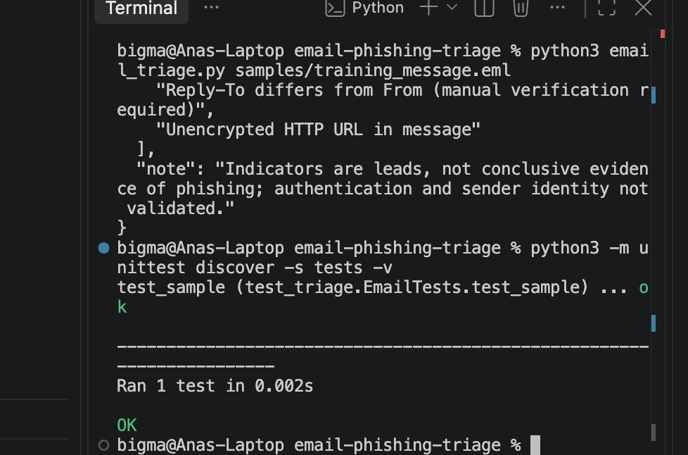

# Digital Forensics Portfolio Project

> Educational demonstration using **synthetic evidence only**. No real person's data is included. Results require analyst validation and should not be treated as proof of wrongdoing.

## Skills demonstrated
RFC email parsing, header review, URL and attachment extraction, indicator reporting, defensible investigative limits.

## Run (Python 3.9+; standard library only)
```bash
python email_triage.py samples/training_message.eml --output report.json
python -m unittest discover -s tests -v
```

## Evidence handling
All example files are fictional. Preserve originals, verify hashes, document timestamps/time zones, and maintain a chain of custody before using any process in a real investigation.

## Limitations
This is **triage**, not attribution or a phishing verdict. It does not perform SPF/DKIM/DMARC verification, URL reputation checks, malware execution, or sandboxing. Never open unknown links or attachments.

## Suggested next steps
Add screenshots from your own run, a sample investigator report, and a brief explanation of what you learned. Only list forensic tools you have personally operated.


## Email Forensics Investigation Results

### Case Overview

**Case ID:** EMAIL-DEMO-001

**Investigation Type:** Suspicious Email and Phishing Indicator Analysis

**Evidence:** Fictional email file (`training_message.eml`)

**Tools Used:** Python 3, Python email.parser, Visual Studio Code, GitHub

### Objective

The objective of this investigation was to analyze a suspicious email, extract relevant forensic artifacts, identify potential phishing indicators, and document findings using a repeatable Python workflow.

### Methodology

1. Imported the fictional `.eml` evidence file into the Python analysis tool.
2. Extracted email metadata, including sender, recipient, subject, date, and reply-to information.
3. Examined the message body for URLs.
4. Checked the message for attachments.
5. Identified indicators requiring additional investigation.
6. Executed an automated Python unit test to validate selected analysis results.

### Findings

**Email Metadata**

- Subject: Training sample – account review
- Sender: support@example.org
- Reply-To: reply@example.net
- Message ID: training-001@example.org
- Attachments: None
- URL identified: `http://example.org/training`

**Indicator 1 — Sender and Reply-To Domain Difference**

The sender and reply-to addresses used different domains. This is an investigative indicator because replies could be directed to an address different from the apparent sender. Additional validation would be required to determine whether this behavior was legitimate.

**Indicator 2 — Unencrypted HTTP URL**

The email contained a URL using HTTP rather than HTTPS. An unencrypted link can present security concerns, but the protocol alone does not establish malicious intent.

### Automated Testing

The Python unit test completed successfully.

- Tests executed: 1
- Tests passed: 1
- Result: OK

### Conclusion

The investigation demonstrated a repeatable process for parsing email evidence, extracting relevant artifacts, and identifying indicators that warrant further examination.

The analysis identified two review indicators. However, these findings do not independently establish that the message is phishing or that its sender is malicious.

**Limitations:** This project uses fictional training data. The tool does not independently validate sender identity, authenticate email delivery, determine URL reputation, or establish malicious intent.


## Automated Test Evidence

The following screenshot documents the successful execution of the Python unit test.


